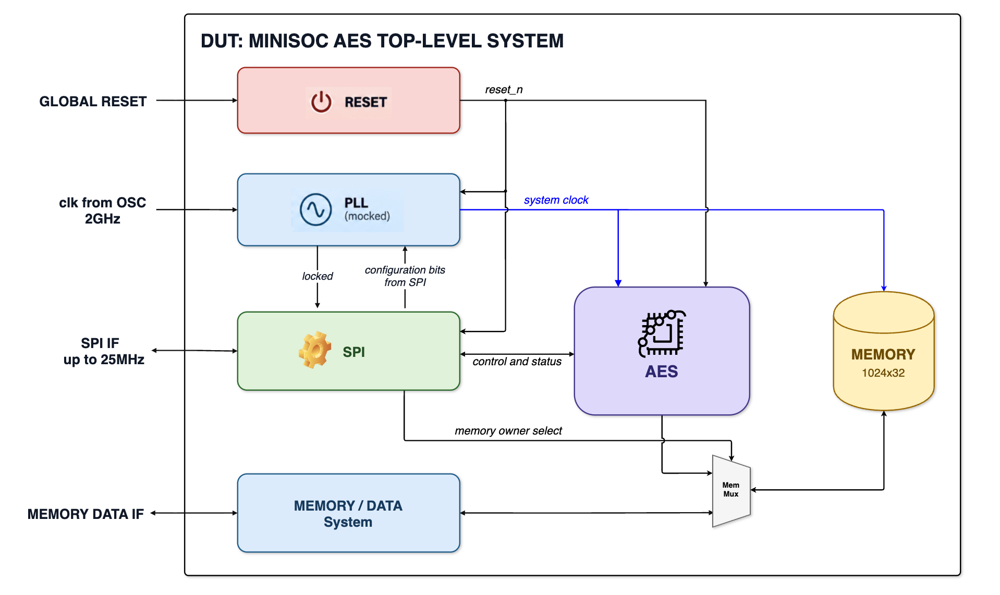

# ciexpert-acelerador-aes-spi

Acelerador AES com interface SPI e baixo consumo. Este projeto faz parte do Hands-on da Trilha de RTL Design da Residência em Microeletrônica CI Expert.

O projeto implementa o **MiniSoC AES**: um sistema de topo com engine AES-128 ([FIPS-197](<docs/spec/FIPS 197, Advanced Encryption Standard (AES) - nist.fips.197.pdf>)) nos modos ECB, CBC, PCBC, CFB, OFB e CTR, configurado por SPI, com PLL mock e uma memória compartilhada de 1024 × 32 bits. O projeto vai do RTL à síntese, passando por verificação formal de equivalência (Formality) e técnicas de baixo consumo descritas em UPF, ao longo de 13 semanas (encerramento em 29/01/2027).

A especificação funcional é o *Block Guide do MiniSoC AES (v1.0.0)*, o mesmo documento usado pela trilha de Design Verification. Ele é confidencial e não é versionado neste repositório.



*Figura 1 – Arquitetura do MiniSoC AES.*

As instruções completas do instrutor (objetivos, cronograma, entregáveis e critérios de aceite) estão em [docs/architecture/instrucoes.md](docs/architecture/instrucoes.md).

## Estrutura do repositório

```
.
├── README.md
├── Makefile             # fluxo de simulação, lint, síntese e formal
├── docs/
│   ├── spec/            # especificação e referências (FIPS-197)
│   ├── architecture/    # instruções, microarquitetura e arquitetura de energia
│   └── reports/         # relatórios semanais
├── rtl/
│   ├── minisoc_aes/     # minisoc_aes_top, minisoc_aes_dp, minisoc_aes_key_exp e submódulos
│   ├── minisoc_mem/     # minisoc_memory
│   ├── minisoc_pll/     # minisoc_pll_mock (modelo de integração)
│   ├── minisoc_spi/     # minisoc_spi
│   └── minisoc_top.sv
├── tb/                  # testbenches e modelo de referência
├── formal/              # scripts e relatórios do Formality
├── syn/                 # SDC, scripts e relatórios de síntese
├── upf/                 # arquivos UPF e relatórios
└── scripts/             # automação do fluxo
```

## Uso

Requer as ferramentas da Synopsys (VCS, Verdi, Design Compiler e Formality).

| Comando | Ação |
|---|---|
| `make run` | Compila e simula o testbench |
| `make lint` | Executa o lint do RTL |
| `make wave` | Abre as formas de onda no Verdi |
| `make synth` | Executa a síntese lógica no Design Compiler |
| `make formality` | Executa a verificação de equivalência RTL × netlist |
| `make clean` | Remove os arquivos gerados |

## Relatórios semanais

| Semana | Tema |
|---|---|
| [01](docs/reports/semana_01.md) | Estudo do AES (FIPS-197) e do SPI |
