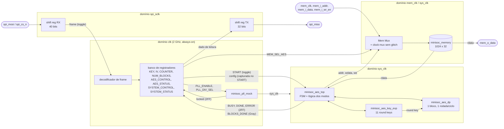
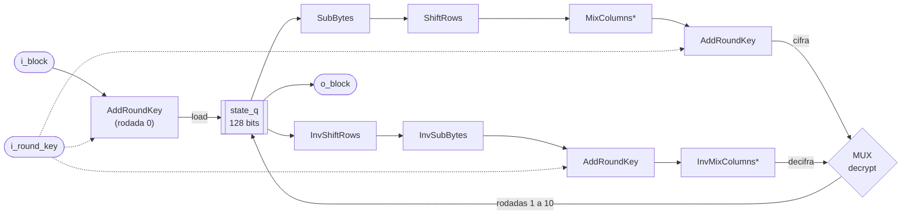
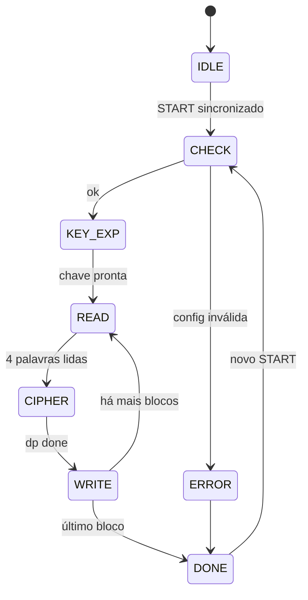

# Microarquitetura do MiniSoC AES — v1.0

> Referências: Block Guide do MiniSoC AES v1.0.0 (interfaces, registradores e protocolo) e [FIPS PUB 197](<../spec/FIPS 197, Advanced Encryption Standard (AES) - nist.fips.197.pdf>).

O Block Guide fixa as interfaces de topo, os módulos, o mapa de registradores e o protocolo SPI. Este documento define **como** esses blocos são implementados: a organização interna, a microarquitetura do AES, a FSM do `minisoc_aes_top`, a estratégia de CDC e a sequência de reset.

## 1. Resumo das decisões

| # | Tema | Decisão |
|---|---|---|
| D1 | Arquitetura do AES | Iterativa: uma rodada por ciclo, com o estado num registrador interno de 128 bits. A memória só é acessada no início (leitura) e no fim (escrita) de cada bloco. |
| D2 | Expansão de chave | As 11 round keys são calculadas uma vez por operação, logo após o START, e guardadas em 11 registradores de 128 bits. |
| D3 | Modos de operação | O `minisoc_aes_dp` processa um único bloco. O encadeamento dos modos (XOR com IV, realimentação, contador do CTR) fica no `minisoc_aes_top`. |
| D4 | Cifra e decifra | Dois caminhos de rodada no `dp`, um direto e um inverso, selecionados por um mux controlado por `decrypt`. |
| D5 | CDC | Toggle para pulsos, configuração capturada no START, BLOCKS_DONE em código Gray, mux de clock sem glitch na memória e sincronizadores de 2 flip-flops para bits de status. |

## 2. Diagrama de blocos interno

O dado lido da memória (`rdata`) vai ao mesmo tempo para a interface externa e para o AES. Só as entradas da memória (endereço, dado de escrita, write-enable e clock) passam pelo Mem Mux.

## 3. Domínios de clock

| Domínio | Clock | Blocos |
|---|---|---|
| SPI | `spi_sclk` (até 25 MHz) | registradores de deslocamento RX e TX |
| Controle | `clk` (2 GHz, always-on) | decodificador de frame, banco de registradores, PLL mock |
| Sistema | `sys_clk` (PLL, 250 MHz a 2 GHz) | `minisoc_aes_top`, `minisoc_aes_key_exp`, `minisoc_aes_dp` |
| Memória | `mem_clk` ou `sys_clk`, conforme `MEM_SEL_AES` | `minisoc_memory` |

## 4. SPI front-end (`minisoc_spi`)

- **Recepção (domínio `spi_sclk`):** um registrador de deslocamento de 40 bits amostra `spi_mosi` na borda de subida (Mode 0, MSB-first). Um contador de bits é zerado com `spi_cs_n = 1`. Ao 40º bit, o frame é copiado para um registrador de retenção e um bit de toggle é invertido.
- **Decodificação (domínio `clk`):** o toggle passa por um sincronizador de 2 flip-flops. Uma mudança no bit sincronizado gera um pulso de 1 ciclo, que captura o registrador de retenção. Ele está estável, porque só muda depois de mais 40 bordas de `spi_sclk`. O campo `RWb` decide entre escrita no registrador `ADDR` e pedido de leitura.
- **Leitura:** o pedido de leitura (1ª transação) guarda o dado do registrador `ADDR` num registrador de saída. Na 2ª transação, endereçada ao NOP, esse valor é carregado no registrador de deslocamento TX na descida de `spi_cs_n` e deslocado em `spi_miso` na borda de descida de `spi_sclk`. Entre as duas transações há tempo de sobra para o dado se estabilizar.
- **START:** a escrita de `START = 1` em AES_CONTROL inverte um bit de toggle, que cruza para o `sys_clk` (seção 7).

## 5. Engine AES

### 5.1 `minisoc_aes_dp`: datapath de um bloco

\* MixColumns e InvMixColumns são pulados na última rodada (rodada 10).

| Sinal | Dir. | Largura | Descrição |
|---|---|---|---|
| `i_clk`, `i_rst_n` | I | 1 | clock e reset do domínio do sistema |
| `i_start` | I | 1 | inicia o processamento de `i_block` |
| `i_decrypt` | I | 1 | 0 = cifra, 1 = cifra inversa |
| `i_block` | I | 128 | bloco de entrada |
| `o_round` | O | 4 | rodada atual, usada para selecionar a round key |
| `i_round_key` | I | 128 | round key da rodada atual, vinda do `key_exp` |
| `o_block` | O | 128 | bloco de saída |
| `o_done` | O | 1 | pulso: `o_block` válido |

- No `i_start`, `state_q <= i_block ^ rk` (rodada 0), com `rk = rk[0]` na cifra ou `rk[10]` na decifra.
- Nas rodadas 1 a 10, `state_q` recebe a saída do mux, uma rodada por ciclo.
- A round key usada na rodada `r` é `rk[r]` na cifra e `rk[10 - r]` na decifra.
- **Latência:** 11 ciclos por bloco (rodada 0 mais 10 rodadas).
- Os blocos combinacionais são os módulos já implementados e verificados (semana 3): `minisoc_aes_sub_bytes`, `shift_rows`, `mix_columns`, `add_round_key` e as inversas.

### 5.2 `minisoc_aes_key_exp`: expansão de chave

- Logo após o START, a chave capturada é copiada para `rk[0]`. A cada ciclo, `rk[i]` é calculada a partir de `rk[i-1]` (RotWord, SubWord com 4 S-boxes, XOR com `Rcon[i]`), até `rk[10]`.
- **Latência:** 10 ciclos, uma vez por operação, e não por bloco.
- As 11 chaves ficam em 11 registradores de 128 bits (1408 flip-flops), selecionados por `o_round` do `dp`. A decifra lê as chaves de 10 para 0 sem custo extra.
- Alternativa avaliada para a síntese (semana 8): expansão on-the-fly, com só 128 bits de registro. Ela economiza área, mas exige derivar as chaves em ordem inversa na decifra.

### 5.3 `minisoc_aes_top`: modos de operação

O `top` mantém um registrador de encadeamento de 128 bits, `chain_q`, iniciado com o IV no START, e o contador de blocos de 64 bits, iniciado com COUNTER no START. Para cada bloco lido da memória (`in`), ele calcula a entrada do `dp` e o resultado gravado (`out`):

| Modo | Primitivo | Entrada do `dp` | `out` | Próximo `chain_q` |
|---|---|---|---|---|
| ECB | cifra/decifra | `in` | `dp` | — |
| CBC (cifra) | cifra | `in ^ chain` | `dp` | `out` |
| CBC (decifra) | decifra | `in` | `dp ^ chain` | `in` |
| PCBC (cifra) | cifra | `in ^ chain` | `dp` | `in ^ out` |
| PCBC (decifra) | decifra | `in` | `dp ^ chain` | `in ^ out` |
| CFB-128 (cifra) | **cifra** | `chain` | `in ^ dp` | `out` |
| CFB-128 (decifra) | **cifra** | `chain` | `in ^ dp` | `in` |
| OFB | **cifra** | `chain` | `in ^ dp` | `dp` |
| CTR | **cifra** | `IV ^ {64'b0, ctr}` | `in ^ dp` | — (`ctr <= ctr + 1`) |

O sentido do primitivo (`i_decrypt` do `dp`) vale `DECRYPT && (MODE ∈ {ECB, CBC, PCBC})`. Em CFB, OFB e CTR o `dp` sempre cifra.

### 5.4 FSM do `minisoc_aes_top`

| Estado | Ação | Saída |
|---|---|---|
| IDLE | espera o START sincronizado; captura KEY, IV, COUNTER, MODE, DECRYPT e NUM_BLOCKS | — |
| CHECK | valida `1 ≤ NUM_BLOCKS ≤ 256` e `MODE ≤ 3'b101` | inválido → ERROR |
| KEY_EXP | espera os 10 ciclos da expansão de chave | → READ |
| READ | lê as 4 palavras do bloco `i` (endereços `4i` a `4i+3`) e monta `in` | → CIPHER |
| CIPHER | aplica a entrada do modo, dispara o `dp` e espera `o_done` | → WRITE |
| WRITE | calcula `out`, escreve as 4 palavras no mesmo endereço, atualiza `chain_q`/`ctr` e incrementa BLOCKS_DONE | mais blocos → READ; senão → DONE |
| ERROR | levanta ERROR e DONE, sem processar blocos | → DONE |
| DONE | DONE sticky até um novo START aceito | novo START → CHECK |

- **BUSY** fica em 1 em CHECK, KEY_EXP, READ, CIPHER e WRITE.
- **Latência estimada por bloco:** cerca de 21 ciclos de `sys_clk` (5 de leitura, com memória síncrona de 1 ciclo, mais 11 de rodadas, 4 de escrita e 1 de transição). Mais 10 ciclos de expansão de chave por operação.

## 6. Memória e arbitragem

- O Mem Mux seleciona, por `MEM_SEL_AES`, endereço, dado de escrita e write-enable: da interface externa (`0`) ou do AES (`1`).
- **Clock da memória:** mux de clock sem glitch entre `mem_clk` e `sys_clk`. Ele desliga o clock atual numa borda baixa e só então habilita o outro, com a seleção sincronizada em cada domínio. Isso evita pulsos curtos durante a troca de ownership.
- `MEM_SEL_AES` só deve mudar com o AES ocioso e sem acesso externo em andamento, como manda o Block Guide.

## 7. Estratégia de CDC

| Cruzamento | Sinal | Técnica |
|---|---|---|
| `spi_sclk` → `clk` | frame completo (pulso) | toggle e sincronizador de 2 FF |
| `spi_sclk` → `clk` | conteúdo do frame (40 bits) | registrador de retenção estável, capturado pelo pulso sincronizado |
| `clk` → `spi_sclk` | dado de leitura (32 bits) | estável entre as duas transações de leitura; carregado na descida de `spi_cs_n` |
| `clk` → `sys_clk` | START (pulso) | toggle e sincronizador de 2 FF |
| `clk` → `sys_clk` | KEY, IV, COUNTER, MODE, DECRYPT, NUM_BLOCKS | estáveis por regra de programação (escritos antes do START); capturados na saída de IDLE |
| `sys_clk` → `clk` | BUSY, DONE, ERROR (níveis) | sincronizador de 2 FF |
| `sys_clk` → `clk` | BLOCKS_DONE (9 bits) | contador em código Gray, 2 FF por bit e conversão para binário |
| PLL → `clk` | `locked` | sincronizador de 2 FF |
| `mem_clk` ↔ `sys_clk` | clock da memória | mux de clock sem glitch |

## 8. Sequência de reset

- `rst_n` é assíncrono na ativação e síncrono na liberação: cada domínio tem o seu sincronizador de reset de 2 FF.
- **Domínio `clk`:** sai do reset logo após `rst_n` subir. O SPI e o PLL ficam disponíveis mesmo sem `sys_clk` (regra de bootstrap).
- **Domínio `sys_clk`:** fica em reset enquanto `locked = 0`. Depois do lock, o reset é liberado só após 16 ciclos de `sys_clk`, contados por um contador no próprio domínio, para garantir uma inicialização determinística.
- **Domínio `spi_sclk`:** o contador de bits e o registrador de deslocamento são zerados por `rst_n` e reiniciados a cada `spi_cs_n = 1`.
- A memória não tem reset (seção 3 do Block Guide).
